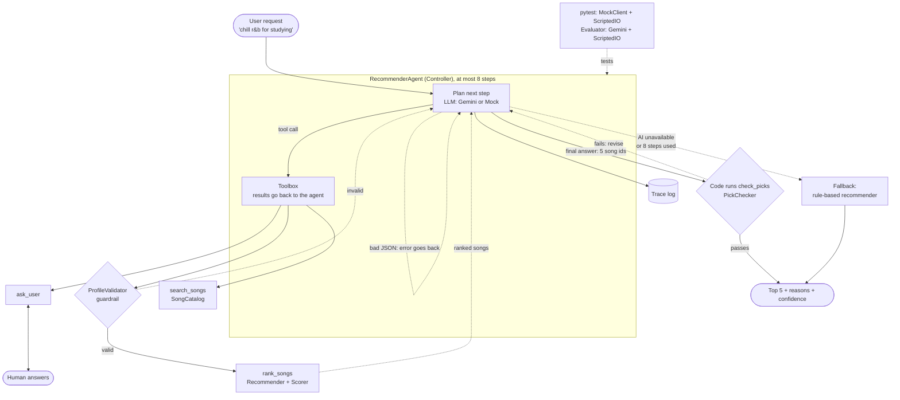
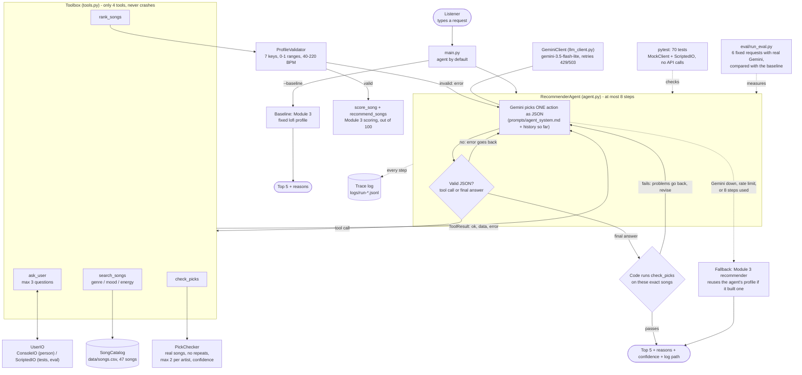

# 🎵 VibeMatch 2.0: An AI Music Recommendation Agent

VibeMatch recommends 5 songs from a 47-song catalog based on what you say you're in the mood for. You type a request like *something chill to study to*. An AI agent (Gemini) asks a follow-up question if it needs one, turns your words into a taste profile, ranks songs with my Module 3 scoring code, and checks its own picks before showing them. The AI decides what to do next; Python code does all the scoring and checking, so the AI can't invent songs or scores.

---

## Built on Module 3

This project (VibeMatch 2.0) extends my Module 3 Music Recommender Simulation (VibeMatch 1.0) from Codepath.

**The original project.** VibeMatch 1.0 was a content-based music recommender. It scored every song in a CSV file against one taste profile written by hand in the code (a favorite genre and mood, plus target values for energy, tempo, valence, danceability and acousticness) and printed the top 5 with the reasons behind each score. It had no AI, couldn't take a request in words, and gave the same answer for the same profile every time.

**What came from Module 3**

- The content-based scoring logic (`score_song`, `recommend_songs`) and its weights
- The command-line runner (`python -m src.main`)
- The original tests in `tests/test_recommender.py`

**What's new in Project 4**

- A new 47-song catalog built around hip-hop, R&B, reggaeton, afrobeats and bachata
- Guardrails (`src/guardrails.py`): a profile validator and a self-check on the picks, with 14 tests
- A song catalog class with search and lookup (`src/catalog.py`), with 9 tests
- A toolbox (`src/tools.py`) that lets the AI use only 4 approved tools, with argument checks and clear errors, with 18 tests
- A Gemini client and an offline mock client (`src/llm_client.py`). Failures give a clear reason instead of crashing, and the API key is never printed. 8 tests, none call the real API
- A multi-step AI agent (`src/agent.py`) that asks follow-up questions, searches, ranks and self-checks its picks, revising when the check fails and falling back to the rule-based recommender if Gemini is down. Every step is logged to `logs/` (`src/trace.py`). 11 tests
- The agent is now the default: `python -m src.main` starts a conversation, and `python -m src.main --baseline` runs the original Module 3 recommender for comparison. 4 tests
- An evaluation script (`python -m eval.run_eval`) that runs the agent on 6 fixed requests and prints a pass/fail table. Latest run: 6 of 6 passed; the Module 3 baseline fit 1 of 6. 4 tests

For the dated, step-by-step history, see [CHANGELOG.md](CHANGELOG.md).

---

## How it works

The agent runs a loop of at most 8 steps. Each step, Gemini reads the request and everything that has happened so far, then picks **one** action as JSON: call a tool, or give a final answer.

| Tool | What it does | Guardrail |
| --- | --- | --- |
| `ask_user` | Asks the listener one follow-up question | At most 3 questions per run |
| `search_songs` | Finds songs by genre, mood (similar moods included) or energy range | Energy must be 0–1 |
| `rank_songs` | Scores songs against a full taste profile with `score_song` | `ProfileValidator` blocks missing keys and impossible values first |
| `check_picks` | Self-checks the final songs | `PickChecker`: real songs only, no repeats, at most 2 per artist; gives a confidence level |

**The code, not the AI, decides when an answer is good enough.** A final answer is accepted only if `check_picks` passes on those exact songs. If it fails, the problems go back to Gemini and it must revise. If Gemini is unavailable or runs out of steps, the Module 3 recommender answers instead, reusing the agent's profile if it built one.

### Data flow

One run, from request to output. This is the simplified view; the full architecture is below. The source is [diagrams/data_flow.mmd](diagrams/data_flow.mmd).



**Input → process → output:** the listener's request goes to the agent. The agent calls tools (ask a question, search, rank), and every result comes back to it. When it gives a final answer, the code checks those exact songs before anything is shown. Dotted lines go back to the agent (to fix an error or revise) or to the fallback. A human is involved at `ask_user`, and the tests and evaluator check the agent from outside.

### Architecture

The full system: every component, where data goes, and where humans and testing check the AI. The source is [diagrams/architecture.mmd](diagrams/architecture.mmd), with an image version at [diagrams/architecture.png](diagrams/architecture.png) for viewers that don't render Mermaid.

**How to read it, top to bottom:**

1. **Input.** The listener types a request. `main.py` starts the agent, or the Module 3 baseline with `--baseline`.
2. **Agent.** `RecommenderAgent` asks Gemini for one action at a time, as JSON. A reply that isn't valid JSON goes back to Gemini to fix.
3. **Toolbox.** The only way Gemini can act. `ask_user` talks to the human through `UserIO`. `search_songs` reads the catalog. `rank_songs` goes through `ProfileValidator`, then my Module 3 `score_song`. `check_picks` uses `PickChecker`. Every tool returns a `ToolResult` to the agent.
4. **Self-check.** When Gemini gives a final answer, the code runs `check_picks` on those exact songs. If it fails, the problems go back to Gemini to revise.
5. **Output.** The top 5 with reasons, a confidence level and the log path.
6. **Safety nets.** If Gemini is down, rate-limited or uses all 8 steps, the fallback (Module 3) answers. Every step goes to the trace log.
7. **Testing.** pytest checks the agent with a fake AI and scripted answers (no API calls); the evaluator measures the real agent on 6 fixed requests.



### How a song is scored

`score_song()` in `src/recommender.py` (unchanged from Module 3) compares each song with a 7-setting taste profile. The agent builds that profile from your words; `--baseline` uses a fixed lofi one.

| Profile setting | Compared with | Max points | How it is scored |
| --- | --- | --- | --- |
| `favorite_mood` | `mood` | 30 | 30 for an exact match, 15 for a mood in the same cluster |
| `favorite_genre` | `genre` | 10 | 10 for an exact match |
| `target_energy` | `energy` (0–1) | 40 | `(1 - abs(song - target)) * 40` |
| `target_valence` | `valence` (0–1, how positive it sounds) | 10 | `(1 - abs(song - target)) * 10` |
| `target_danceability` | `danceability` (0–1) | 8 | `(1 - abs(song - target)) * 8` |
| `target_acousticness` | `acousticness` (0–1) | 7 | `(1 - abs(song - target)) * 7` |
| `target_tempo` | `tempo_bpm` | 5 | `(1 - abs(song_bpm - target_bpm) / 120) * 5` |

The points add up to 110, because my Module 3 weight experiment halved genre (20 → 10) and doubled energy (20 → 40). The total is divided by 110 and multiplied by 100, so every score is out of 100, like turning test points into a percentage. Rescaling doesn't change the order of the songs.

**Mood clusters** give partial credit for similar moods:

| Cluster | Moods |
| --- | --- |
| Calm | chill, relaxed, peaceful, focused, dreamy, reflective |
| Happy | happy, uplifting, euphoric, celebratory, carefree, playful, whimsical, mischievous |
| Intense | intense, angry, aggressive, anxious, rebellious, overwhelmed |
| Energetic | energetic, confident, determined, adventurous |
| Romantic | romantic, passionate |
| Longing | sad, melancholic, yearning, nostalgic |
| Moody | moody, mysterious, uncertain |

**Confidence** comes from the top song's score: 80 or more is high, 60 to 79 is medium, under 60 is low. It measures how good a match exists in the catalog for this request, not whether you will like the songs.

---

## Setup

1. Create and turn on a virtual environment:

   ```bash
   python -m venv .venv
   source .venv/bin/activate      # Mac or Linux
   .venv\Scripts\activate         # Windows
   ```

2. Install the dependencies:

   ```bash
   pip install -r requirements.txt
   ```

3. Add your Gemini API key. Get a free key at [Google AI Studio](https://aistudio.google.com/apikey), then:

   ```bash
   cp .env.example .env
   ```

   Open `.env` and replace `your_api_key_here` with your key. `.env` is in `.gitignore`, so it is never committed. Check that it works (this prints only "works" or "doesn't work", never the key):

   ```bash
   python -m src.llm_client
   ```

   Without a key the app still runs: it falls back to the rule-based recommender and says so.

## Running it

```bash
python -m src.main                                   # the AI agent: asks what you're in the mood for
python -m src.main --request "chill r&b to study to" # skip the first question
python -m src.main --baseline                        # the original Module 3 recommender
python -m pytest -q                                  # 70 tests, no API calls
python -m eval.run_eval                              # evaluation with real Gemini (about 3 minutes)
```

Every agent run writes a step-by-step log to `logs/` (one JSON object per line). It records Gemini's one-sentence reason for each step, every tool call, any error or fallback, and the final songs. The path is printed at the end of each run.

---

## Sample runs

These are real outputs from Nov 18, 2026. Gemini's wording and picks vary a little between runs; the scores always come from the code. Reasons are shown for the first song only, to keep this short.

**1. A clear request: study music**

```text
$ python -m src.main --request "something chill to study to"

Thinking...

Here are 5 chill tracks tailored for your study session, featuring mellow lofi beats, ambient soundscapes, and smooth R&B!

Top 5 recommendations
============================================================
1. Library Rain - Paper Lanterns (lofi, chill)
   Final score: 94.83 / 100
   Reasons:
   - mood match: chill (+30 points)
   - genre match: lofi (+10 points)
   - energy closeness: 38.00/40 points
   - valence closeness: 9.00/10 points
   - danceability closeness: 6.56/8 points
   - acousticness closeness: 5.88/7 points
   - tempo closeness: 4.88/5 points
------------------------------------------------------------
2. Spacewalk Thoughts - Orbit Bloom (ambient, chill)       86.78 / 100
3. Pink Dolphin Sunset - Tory Lanez (r&b, chill)           81.60 / 100
4. Focus Flow - LoRoom (lofi, focused)                     79.76 / 100
5. Blue Dream - Jhené Aiko (r&b, dreamy)                   73.45 / 100
------------------------------------------------------------
Confidence: high  |  Agent steps: 4
Step-by-step log: logs/run-20261118-123723-242177.jsonl
```

**2. A different mood: party music**

```text
$ python -m src.main --request "high energy songs for a party"

Thinking...

Here are 5 high-energy party anthems spanning pop, afrobeats, reggaeton, and more to get your crowd moving!

Top 5 recommendations
============================================================
1. Sunrise City - Neon Echo (pop, happy)                    81.68 / 100
2. Body Go - MOLIY & Tyla (afrobeats, euphoric)             80.98 / 100
3. Bendecido - El Alfa & FARIANA (reggaeton, celebratory)   73.42 / 100
4. Anybody - Burna Boy (afrobeats, celebratory)             69.92 / 100
5. Believe What I Say - Kanye West (hip-hop, uplifting)     66.59 / 100
------------------------------------------------------------
Confidence: high  |  Agent steps: 3
```

**3. A vague request: the agent asks a follow-up question**

```text
$ python -m src.main

What are you in the mood for? (for example: chill r&b to study to)
> recommend me some music

Thinking...

What kind of genre or mood are you in the mood for today?
> afrobeats, something happy

Here are 5 happy and vibrant tracks, featuring some fantastic upbeat afrobeats and pop to brighten your day!

Top 5 recommendations
============================================================
1. Sunrise City - Neon Echo (pop, happy)                    89.14 / 100
2. Anybody - Burna Boy (afrobeats, celebratory)             83.96 / 100
3. Body Go - MOLIY & Tyla (afrobeats, euphoric)             81.39 / 100
4. Body & Soul - Joeboy (afrobeats, playful)                80.08 / 100
5. On the Low - Burna Boy (afrobeats, carefree)             78.22 / 100
------------------------------------------------------------
Confidence: high  |  Agent steps: 4
```

Full, unedited outputs of these runs, the baseline, a trace log, the test run and the evaluation are saved in [assets/evidence/](assets/evidence/).

**Compared with the baseline.** `python -m src.main --baseline` ignores what you want and always returns the same lofi list: Midnight Coding 98.50, Library Rain 97.12, Focus Flow 86.20, Pink Dolphin Sunset 85.57, Spacewalk Thoughts 82.95. The agent's results change with the request; the scoring code is the same.

---

## Reliability and guardrails

All four reliability methods from the project spec are used:

| Method | Where | Result |
| --- | --- | --- |
| Automated tests | `tests/` (pytest, `MockClient` and `ScriptedIO`, no API calls) | 70 of 70 pass |
| Confidence scoring | `PickChecker` rates every result high / medium / low | Shown on every run |
| Logging and error handling | Every tool returns `ok` + `error` instead of crashing; `TraceLogger` writes each step to `logs/` | Errors go back to the agent to fix; failures fall back with a reason |
| Human evaluation | I judge the agent's picks for the 6 eval requests | Table in [model_card.md](model_card.md) |

**Guardrail examples** (real outputs from the code):

| Input | What the system does | Result |
| --- | --- | --- |
| The AI asks for a tool that doesn't exist (`delete_all_songs`) | `Toolbox` refuses it | `unknown tool 'delete_all_songs'. Allowed: ask_user, search_songs, rank_songs, check_picks` |
| A profile with energy 7 | `ProfileValidator` blocks ranking | `invalid profile: target_energy must be between 0 and 1, got 7` |
| A profile with tempo 900 BPM | `ProfileValidator` blocks ranking | `invalid profile: target_tempo must be between 40 and 220, got 900` |
| A profile missing a setting | `ProfileValidator` blocks ranking | `invalid profile: missing keys: target_valence` |
| A genre the catalog doesn't have (polka) | Ranking runs, with a warning | `unknown genre 'polka': no song will earn genre points` |
| The AI ranks a song id that doesn't exist (999) | `rank_songs` refuses it | `unknown song ids: [999]` |
| The AI's final picks include a made-up song | `PickChecker` fails the check; the agent must revise | `not in catalog: None (id 999)` |
| 3 songs by the same artist | `PickChecker` fails the check; the agent must revise | `too repetitive: 3 songs by burna boy (max 2)` |
| The AI tries to finish before ranking | The final answer is refused | `call rank_songs before check_picks` |
| A 4th follow-up question | `ask_user` refuses it | `question limit reached (3); rank with what you know` |
| The AI replies with plain text instead of JSON | The error goes back to the AI; the run continues | `reply was not a JSON object` |
| Gemini is down (a real 503 during testing) or no key is set | The Module 3 recommender answers | `Note: The AI agent couldn't finish, so these come from the rule-based recommender.` plus the reason |

## Evaluation

`python -m eval.run_eval` runs the agent with real Gemini on 6 fixed requests. Scripted answers stand in for the listener. A case passes only if the agent finishes on its own, recommends only real songs that pass the self-check, stays within 8 steps, and meets the case's fit rule (for example, "3+ of 5 are bachata"). The same rule is applied to the baseline.

| Case | Request | Fit rule | Agent | Confidence | Steps | Baseline fits? |
| --- | --- | --- | --- | --- | --- | --- |
| Study music | something chill to study to | 3+ of 5 have a calm mood | PASS | high | 3 | yes |
| Party | high energy songs for a party | 3+ of 5 have energy 0.7 or more | PASS | high | 3 | no |
| Named genre | romantic bachata | 3+ of 5 are bachata | PASS | high | 3 | no |
| Sad mood | sad songs for a rainy day | 2+ of 5 have a sad or longing mood | PASS | high | 3 | no |
| Vague request | recommend me some music | asks a question; 2+ of 5 are afrobeats | PASS | high | 4 | no |
| Genre not in catalog | polka music for my grandma | only real songs; 2+ of 5 have a happy mood | PASS | high | 5 | no |

**Summary:** 6 of 6 cases passed. Confidence was high in 6 of 6. The Module 3 baseline fit 1 of 6 requests.

It took three runs to get there. Run 1 scored 5 of 6 because running the cases back to back hit Gemini's free-tier limit of 15 requests a minute. Run 2 scored 5 of 6 because the agent kept searching for "sad" songs and ran out of steps. Run 3 scored 6 of 6 after one prompt change telling it to rank the whole catalog instead. The full table, run history and human evaluation are in the [model card](model_card.md).

---

## Testing summary

**What worked:**
- All 70 automated tests pass, and none of them call the real API. A fake AI (`MockClient`) and scripted answers (`ScriptedIO`) let me test every path for free, including bad JSON, unknown tools, invented songs and Gemini being down.
- The guardrails caught every bad input I tried (the table above).
- The fallback worked during a real outage: Gemini returned a 503 mid-run, and the app still gave good songs by reusing the agent's profile.
- On the evaluation, the agent fit 6 of 6 requests; the Module 3 baseline fit 1 of 6.

**What didn't work at first:**
- Running the evaluation cases back to back hit Gemini's free-tier limit of 15 requests a minute. I added a 20-second pause between cases.
- The agent searched over and over for "sad" songs and ran out of steps. One paragraph in the prompt (rank the whole catalog instead) fixed it, and steps per request dropped from up to 8 to 3–5.
- A blank `GEMINI_API_KEY` already set in my terminal hid the real key in `.env`, so a run fell back. I made `.env` take priority.
- The model name copied from an earlier project returned 404, so I pinned a specific version.

**What I learned:** unit tests with a fake AI prove the code is correct, but only running the real AI shows how it behaves. Two of my four problems only showed up with real Gemini calls.

---

## Design decisions

| Decision | Why | Trade-off |
| --- | --- | --- |
| **The AI decides, the code scores and checks** | Gemini only picks the next step from 4 tools; scores come from `score_song` and every answer passes `PickChecker`. It can't invent songs or scores. | Gemini can't do anything clever outside those 4 tools |
| **One multi-step agent, not several agents** | One loop is easier to test, log and explain, and it's enough for this task | Less flexible than a team of specialized agents |
| **Reuse my Module 3 scoring unchanged** | Scores stay explainable, and the baseline comparison is fair: same math, different profile | The scoring's limits (one genre, exact genre match) carry over |
| **Fallback to Module 3, reusing the agent's profile** | The app always answers, and still fits the request if Gemini already understood it | A fallback with no profile gives generic results |
| **A fake AI for tests** | Tests are free, fast and give the same result every time | Can't catch real-AI problems; the evaluator does that |
| **Errors come back with a reason, not an empty string** | Every failure can be logged and explained | A little more code than returning `""` |
| **Pinned model, low temperature (0.2)** | Steadier tool choices; behavior doesn't change when Google updates an alias | Must update the model name by hand later |
| **Catalog from my own library** | I can only judge a recommendation if I know the song | The catalog is small, and the song features are my estimates |
| **Scores rescaled from 110 to 100** | Keeps my weight experiment exactly as designed and keeps scores readable | None for the ranking: the order is the same |

More detail, with GRASP and SOLID, is in [docs/design.md](docs/design.md).

---

## Limitations

- **The song features are estimates.** Energy, valence and the other numbers for the 37 real songs are my own guesses about how they sound, not official data. A wrong guess moves a song up or down.
- **The catalog is small and unbalanced.** 47 songs: r&b has 11 and afrobeats 10, but hip-hop has 2 and most contrast genres have 1. Some requests have no perfect match, which shows up as medium confidence.
- **"Good" music is personal.** For a request like "music to study", the agent guesses a calm, lofi-style profile, but some people study to rap or to songs they love. It only asks a follow-up when a request sounds unclear, so specific requests ("chill r&b to study to") work best.
- **One genre and one mood per profile.** A listener who likes several genres has to pick one.
- **Genre is exact-match only.** Lofi gets no credit for ambient or jazz, even though they sound alike.
- **No listening history.** The system can't learn from plays, skips or likes, so it can't tell what you actually enjoy.
- **Gemini's choices vary.** The same request can give slightly different profiles and picks between runs. The guardrails keep every result real and checked, but not identical.
- **Free-tier limits.** Gemini's free tier allows 15 requests a minute; one agent run uses 3 to 5. If a limit is hit, the app falls back instead of failing.
- **The `Recommender` class is still a starter stub.** `Recommender.recommend()` returns the first *k* songs without scoring, and `explain_recommendation()` returns a placeholder. The app never uses it. The starter tests in `tests/test_recommender.py` still pass, but only because the expected pop song happens to be first in the test's list and the placeholder text isn't empty. The real scoring is `score_song` and `recommend_songs`.

---

## Reflection

This project taught me that adding AI to a system is mostly about deciding what the AI should **not** do. Letting Gemini choose the next step made the recommender understand plain requests, but the parts I trust are the ones in code: the scoring, the checks and the fallback. It also showed me that you can't judge an AI system by reading it. I only found the rate limit and the over-searching by running the real agent and measuring it.

My full responsible-AI reflection (how I worked with AI, one suggestion I accepted and one I didn't, limitations, misuse and what surprised me) is in the [**Model Card**](model_card.md).
