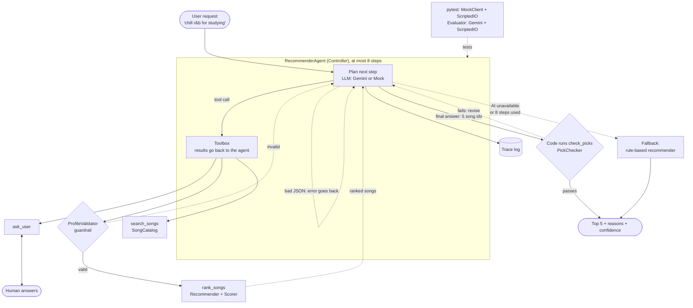

# VibeMatch 2.0: System Design

**Status:** in progress. Parts marked *Existing* or **Built** exist in code; the rest are planned. `diagrams/architecture.mmd` shows only what is built, and is updated as each part ships.

**Base project:** VibeMatch 1.0, the Module 3 Music Recommender Simulation. It scores every song in `data/songs.csv` against a fixed taste profile and prints the top 5 with reasons.

**What 2.0 adds:** a multi-step AI agent that plans its own steps (ask about your taste, search songs, rank them, check its own picks), plus a reliability layer (guardrails, fallback, logging, and an evaluation script).

---

## 1. Integration rule

The project requires the AI feature to be part of the main application and to change how the system behaves. It cannot be a standalone script or AI text printed next to the old answer. This design meets that rule as follows:

- `python -m src.main` runs the **agent by default**. The old rule-based recommender runs only as a **fallback** (AI unavailable) or with `--baseline` for comparison.
- The agent's decisions **change the results**: the profile it builds decides which songs are ranked, a follow-up question can change the profile, and a failed self-check makes it re-rank.
- Explanations come from the **real scoring reasons** returned by `score_song`, not from text the LLM makes up.

## 2. Components

| # | Component | File | Job | Status |
|---|---|---|---|---|
| 1 | `Song`, `UserProfile` | `src/models.py` | Hold song and listener data, plus the shared mood clusters | **Built** (Nov 18, moved out of `recommender.py`) |
| 2 | `SongCatalog` | `src/catalog.py` | Load `songs.csv`, search songs, look up a song by id | **Built** (Nov 18) |
| 3 | `Scorer` | `src/recommender.py` | Score one song against a profile, with reasons | Existing `score_song` |
| 4 | `Recommender` | `src/recommender.py` | Rank candidates, return the top *k* | Existing `recommend_songs` |
| 5 | `ProfileValidator` | `src/guardrails.py` | Check the profile: values in 0–1, sensible BPM, known genres and moods | **Built** (Nov 18) |
| 6 | `PickChecker` | `src/guardrails.py` | Self-check picks: songs exist, enough variety, confidence level | **Built** (Nov 18) |
| 7 | `LLMClient` → `GeminiClient`, `MockClient` | `src/llm_client.py` | Talk to the AI, or a fake AI for tests; failures raise `LLMError` with a reason | **Built** (Nov 18) |
| 8 | `Toolbox` | `src/tools.py` | List the tools the agent may call and run them; refuse anything else | **Built** (Nov 18) |
| 9 | `RecommenderAgent` | `src/agent.py` | Run the loop: plan → ask → search → rank → check → revise | **Built** (Nov 18, AI feature) |
| 10 | `UserIO` → `ConsoleIO`, `ScriptedIO` | `src/user_io.py` | Ask the human questions, live or scripted for tests | **Built** (Nov 18, human-in-the-loop) |
| 11 | `TraceLogger` | `src/trace.py` | Record every step to a log file | **Built** (Nov 18, logging) |
| 12 | Evaluator | `eval/run_eval.py` | Run 6 fixed requests with real Gemini and scripted answers, print a pass/fail table and summary line, compare with the baseline | **Built** (Nov 18, testing) |
| 13 | CLI | `src/main.py` | Build the objects and start a run; agent by default, `--baseline` for Module 3 | **Built** (Nov 18) |

### Agent tools

| Tool | What it does | Built from |
|---|---|---|
| `ask_user(question)` | Asks the user a follow-up question | `UserIO` |
| `search_songs(filters)` | Finds candidate songs by genre, mood or energy range | `SongCatalog` |
| `rank_songs(profile)` | Scores and ranks songs with reasons | `Recommender` + `Scorer` |
| `check_picks(song_ids, profile)` | Checks the picks before output | `PickChecker` |

## 3. GRASP principles

| Principle | Meaning | Where it is applied |
|---|---|---|
| Information Expert | Give a job to whoever has the data | `SongCatalog` answers "does this song exist?"; `Scorer` owns the weights and computes scores |
| Creator | Whoever owns or uses objects creates them | `SongCatalog` creates `Song` objects; `main.py` creates the agent and its parts |
| Controller | One class receives requests and coordinates | `RecommenderAgent` directs the work but never scores or searches itself |
| Low Coupling | Parts depend on each other as little as possible | The agent reaches code only through `Toolbox`; swapping the AI provider changes one file |
| High Cohesion | Each class does one focused job | Validation, checking, logging and scoring each live in their own class |
| Polymorphism | Same interface, different behavior | `GeminiClient` / `MockClient` and `ConsoleIO` / `ScriptedIO` are interchangeable |
| Pure Fabrication | Helper classes that are not real-world objects | `Toolbox`, `TraceLogger`, `ProfileValidator`, `PickChecker` |
| Indirection | A middleman between two parts | `Toolbox` sits between the LLM and Python functions; the LLM asks by name, the Toolbox decides |
| Protected Variations | Shield the system from parts likely to change or fail | `LLMClient` hides the AI provider; the fallback keeps the app working if the AI is down |

## 3b. SOLID principles

GRASP decides which class owns each job; SOLID keeps those classes easy to change and test. The AI (Gemini) is one component behind an interface, so the same rules apply.

| Principle | Meaning | Where it is applied | Status |
|---|---|---|---|
| Single Responsibility | Each class has one reason to change | `ProfileValidator` and `PickChecker` each do one job. Step 2 split `recommender.py`: data shapes and mood clusters in `models.py`, loading and search in `catalog.py`, and only scoring and ranking left in `recommender.py` | **Built** |
| Open/Closed | Add features without editing working code | New agent tools are added to `Toolbox` (one method + one entry in `TOOL_SPECS`) without changing the agent; weights and mood clusters are named constants | Partly built |
| Liskov Substitution | A subclass can replace its parent safely | `MockClient` and `GeminiClient` both return text, and both raise `LLMError` on failure, so the agent behaves the same with either | **Built** |
| Interface Segregation | Small, focused interfaces | `UserIO` has one method (`ask`) and `LLMClient` has one (`complete`) | **Built** |
| Dependency Inversion | Depend on abstractions; pass dependencies in | `ProfileValidator` receives the genre list and `PickChecker` receives the songs. The agent receives its LLM client, toolbox and trace logger, so tests pass `MockClient` and `ScriptedIO` | **Built** |

## 4. Data flow

A simplified view of one run (also saved as [diagrams/data_flow.mmd](../diagrams/data_flow.mmd)). The full architecture, with every file, the baseline and the tests, is in [diagrams/architecture.mmd](../diagrams/architecture.mmd) (also shown in the README).

Main path, top to bottom: request → agent → toolbox → validator → rank → the agent picks songs → the code checks those exact songs → output. Dotted lines go back to the agent or to the fallback. Every tool result returns to the agent, which plans the next step.

## 5. Where humans and testing check the AI

| Checkpoint | Type | What it checks |
|---|---|---|
| `ask_user` | Human | The user confirms their taste before ranking |
| `ProfileValidator` | Guardrail | The AI built a valid profile |
| `PickChecker` | Self-check | Picks are real songs, varied, and confident enough |
| Trace log | Human review | Every decision can be read afterward |
| pytest + `MockClient` | Testing | Tools, guardrails and the LLM client's error handling work, with no API calls |
| Evaluator | Testing | The full agent on fixed requests, with a pass/fail summary |

## 6. Limits on the agent

- About 8 steps and 3 questions per run.
- Every recommended song must exist in `songs.csv`.
- If the LLM is unavailable (no key, network error, rate limit, empty reply), the client raises `LLMError` with the reason; the app logs it, runs the rule-based recommender, and says so.
- The API key never appears in output or logs: `GeminiClient` replaces it with `[hidden]` in any error message.

## 7. Evidence that the feature changes behavior

The README will show the same request run with `--baseline` and with the agent, side by side. The outputs should differ because the agent builds the profile from the conversation and can re-rank after its self-check.

## 8. How the design meets spec parts 4 and 5

### Part 4: Reliability and evaluation

The spec asks for at least one method. This design uses all four:

| Method | Where | Evidence (text, not screenshots) |
|---|---|---|
| Automated tests | `tests/` (pytest, `MockClient`, `ScriptedIO`, no API calls) | Pass count in README |
| Confidence scoring | `PickChecker` rates each result high / medium / low from the top score | Shown in every run's output; average reported by the evaluator |
| Logging and error handling | Every tool returns `ok` + `error`; `TraceLogger` writes each step, failure and reason to `logs/` | A sample trace excerpt in README |
| Human evaluation | I review the agent's picks for fixed requests | Markdown table in `model_card.md`: Test input · Evaluation criteria · Result |

`eval/run_eval.py` prints a summary line in the spec's format, for example: "5 of 6 cases passed; the agent struggled when the request named no genre."

### Part 5: Reflection and ethics (in `model_card.md`)

| Section header | Source material |
|---|---|
| Limitations and biases | Estimated song features, small catalog, the mood-over-genre weighting, the LLM misreading slang |
| Misuse and prevention | Prompt injection through the request, invented songs, cost abuse; prevented by the toolbox allow-list, `PickChecker`, and step/question limits |
| What surprised me in reliability testing | Findings from the evaluator and the human evaluation table |
| AI collaboration | The AI collaboration log in my design doc: at least one suggestion accepted and one changed or rejected, with reasons |
